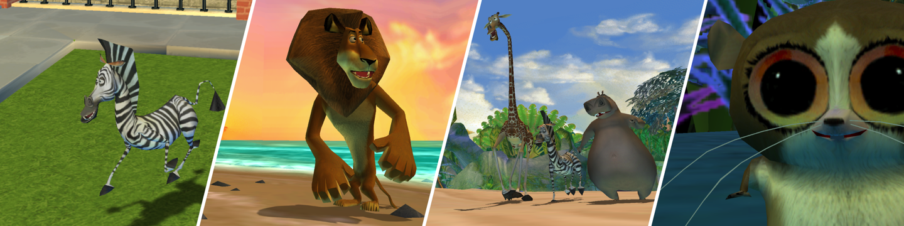

<h1 align="center">Zoosters</h1>

A native port of <i>Madagascar</i> (2005, PC)

  <a href="https://github.com/zoosters/zoosters/releases">Download</a> |
  <a href="BUILDING.md">Build</a> |
  <a href="https://github.com/zoosters/zoosters/wiki">Wiki</a>

## Getting started
1. Install the original PC game
2. Download Zoosters and `Zoosters-Mod.zip`
3. Put Zoosters in the game folder, unzip the Mod zip there and start it

Linux: add OpenAL with `sudo apt install libopenal1`.

## Features
- **Widescreen and ultrawide** without stretching, at any resolution
- **Native 64-bit** for Apple Silicon and x64, no emulator, no wrapper
- **Controllers just work**: Xbox, PlayStation, Switch Pro and most other pads are detected and mapped automatically, rumble included
- **Settings in the game**: no launcher, volume, rumble, shadows and draw distance live in the title and pause menus and apply right away
- **Plays like the original\***: physics, scripts and levels are the 2005 game's, checked frame by frame

\* Kinda. The original ran some fancy floating-point maffs on x87 that you can't get on 64-bit (or I didn't care for), so some movement tech like collision abuse might not work

## Your files
Saves, `settings.ini` and the log (`port.log`) are in
- macOS: `~/Library/Application Support/Activision/Madagascar`
- Windows: `Documents\Activision\Madagascar`
- Linux: `~/.local/share/Activision/Madagascar`

## Status
- macOS (Apple Silicon): playable
- Windows: builds, untested
- Linux: untested

## License
GPLv3. No game data included, bring your own copy. Credits in [NOTICE.md](NOTICE.md).

<i>Madagascar</i> is a trademark of DreamWorks Animation. Unofficial fan project, not affiliated with DreamWorks Animation, Activision or Toys for Bob
